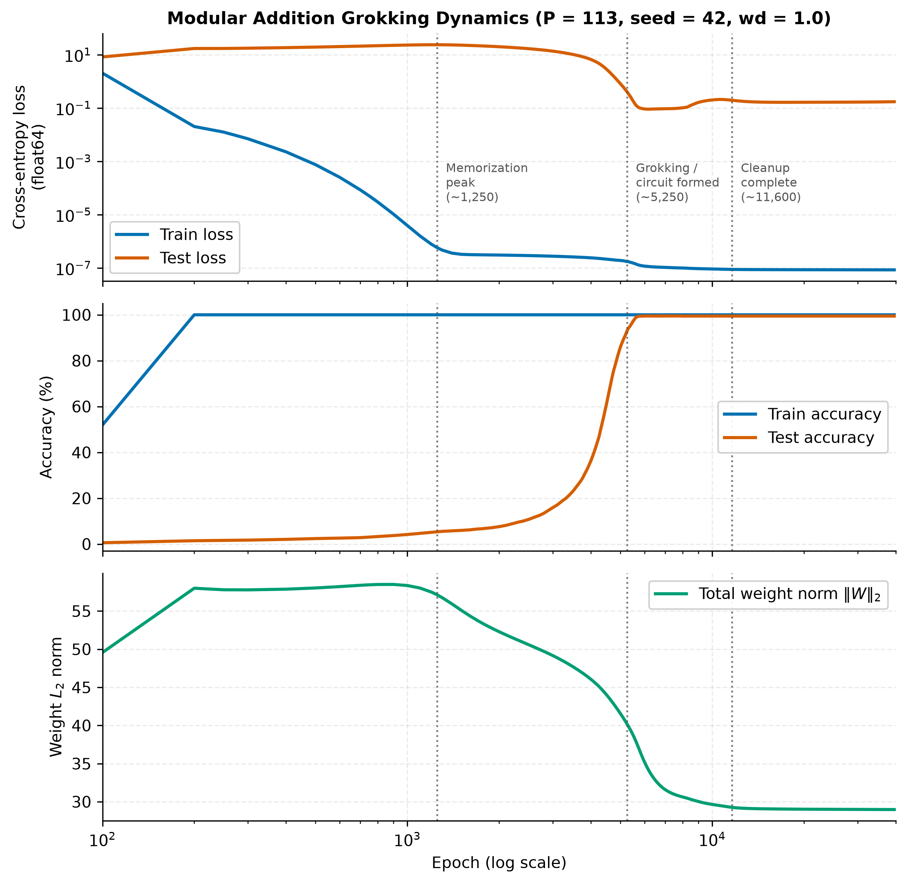
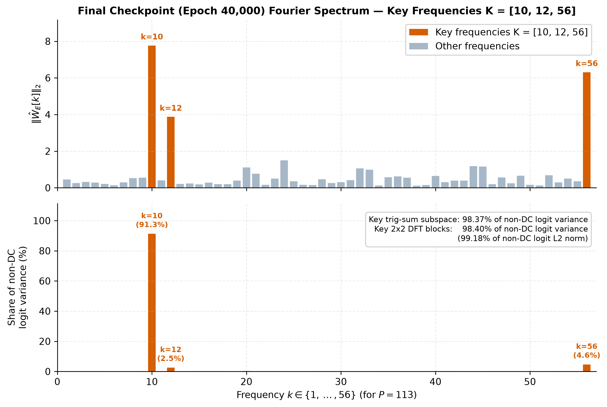
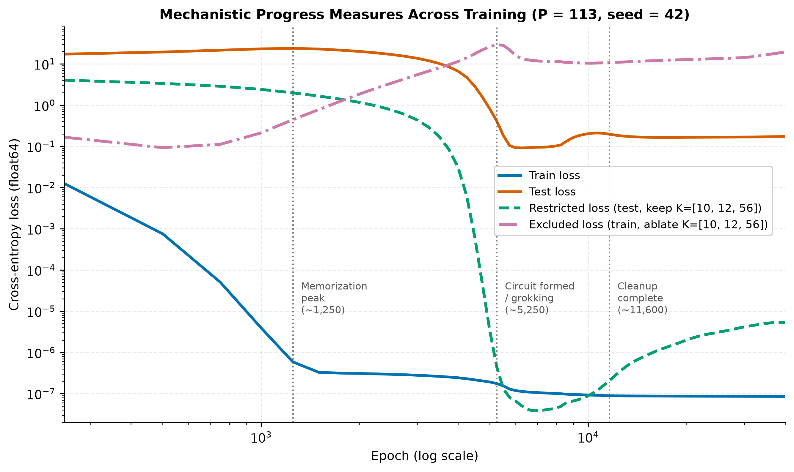
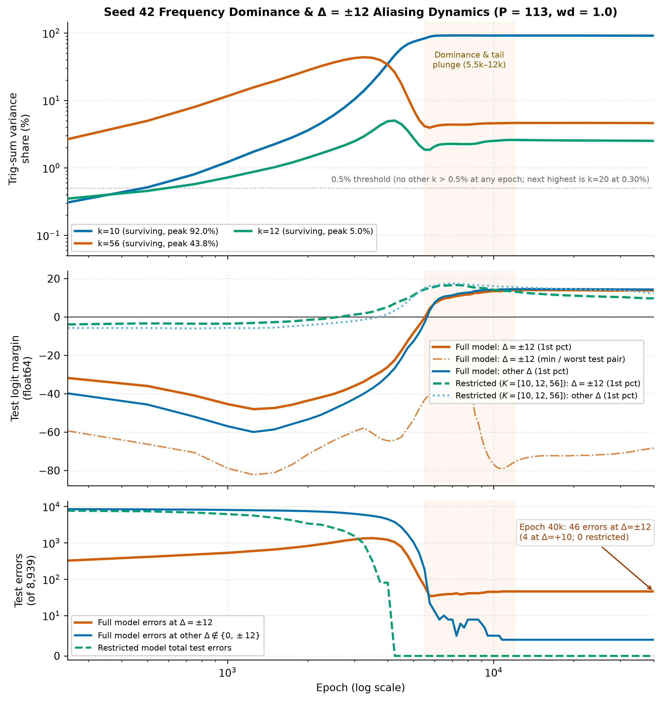
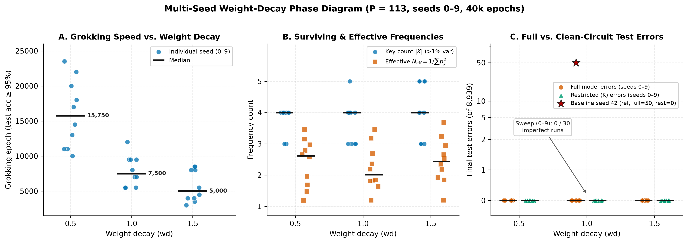
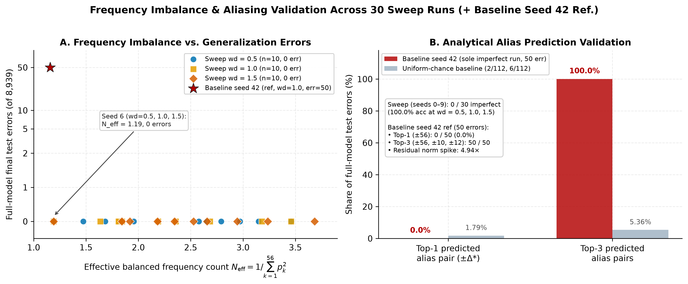

# Progress Measures for Grokking — From-Scratch Reproduction & Weight-Decay Aliasing Study

From-scratch PyTorch + `einops` reproduction of **Nanda et al. (2023)**, *"Progress measures for grokking via mechanistic interpretability"*, extended with a zero-training aliasing diagnostic (Stage 4A), a 30-run multi-seed weight-decay sweep (Stage 4B), and a `seed = 42` double-dissociation control.

> **TL;DR** — I re-implemented a 1-layer transformer from scratch (PyTorch + `einops`) and reproduced Nanda et al.'s finding that, on modular addition, the model first memorises and then suddenly *generalises* ("grokking") by learning a small set of Fourier frequencies. Extending the paper:
> - The baseline model's remaining test errors are **predictable from its learned frequencies**: all 50 / 50 errors land on the 3 offsets my diagnostic predicts (vs. 5.4% by chance).
> - Across a **30-run weight-decay × seed sweep**, time-to-generalise scales roughly as `1 / weight_decay`, while *which* frequencies the model learns is fixed by the random seed (24× higher overlap within a seed than across seeds).
>
> **Stack:** PyTorch, einops, NumPy/SciPy, pytest · each 40k-epoch run takes ~90 s on an RTX 5070.

---

## 1. Task, Architecture & Numerics

- **Task:** Modular addition `(a + b) mod 113` formatted as 3 tokens `[a, b, =]` (`=` has ID `113`, vocab `114`, output classes `113`, target at final position index `2`). Deterministic 30% / 70% disjoint split (`3,830` train / `8,939` test pairs covering all `113 × 113 = 12,769` pairs).
- **Model ([`src/model.py`](src/model.py)):** 1-layer causal Transformer decoder (**226,688** params), no LayerNorm, learned positional embeddings (length `3`), untied `W_E` and `W_U`, ReLU MLP with biases (`b_in`, `b_out`), no attention/unembedding biases, `1 / sqrt(fan_in)` normal init, `d_model = 128`, `n_heads = 4` (`d_head = 32`), `d_mlp = 512`. All 9 weight matrices (`W_E, W_pos, W_Q, W_K, W_V, W_O, W_in, W_out, W_U`) are directly accessible `nn.Parameter`s; token lookup uses `F.embedding(tokens, self.W_E)` for bit-exact CPU + CUDA determinism.
- **Optimization ([`src/train.py`](src/train.py)):** Full-batch `AdamW` (`lr = 1e-3`, `betas = (0.9, 0.98)`, uniform `weight_decay`), `40,000` epochs, with logits cast to **`torch.float64`** prior to `F.cross_entropy` to prevent `float32` softmax underflow / slingshots.
- **Hardware & throughput:** NVIDIA GeForce RTX 5070 (12 GB VRAM), `torch 2.15.0+cu132`, `einops 0.8.2`. Full 40,000-epoch run takes **~88–90 s** (`2.25 s / 1k epochs`), **265.2 MB** peak allocated VRAM, **889.8 KB** per model-only checkpoint.

---

## 2. Baseline Reproduction (`seed = 42`, `wd = 1.0`)

Across `40,000` epochs (`161` checkpoints saved every `250` epochs), the model reproduces all three mechanistic phases of grokking:

| Phase | Approx. Epochs | Quantitative Signature |
| :--- | :--- | :--- |
| **1. Memorization** | `0 → ~1,250` | `train_acc` reaches `100%` by ep `200`; `test_loss` peaks at `23.81` (`ep 1,250`, `test_acc = 5.35%`); weight norm peaks at `58.48` (`ep 900`); `excluded_train_loss` drops to `0.093` (`ep 500`). |
| **2. Circuit Formation** | `~500 → ~5,250–5,500` | While full `test_loss` stays elevated (`23.8 → 13.7`), `restricted_test_loss` drops monotonically (`3.37 → 1.99 → 0.436 → 1.32e-7`), crossing `< 1e-6` at `ep 5,250`. Full `test_acc` crosses `95%` at `ep 5,400` (`99.46%` at `ep 6,000`); `excluded_train_loss` peaks at `28.31` (`ep 5,500`). |
| **3. Cleanup** | `~5,500 → ~11,600` (stable to `40,000`) | Total weight L2 norm drops to within 1% of its asymptote (`28.98`) by `ep 11,600`. Key-frequency variance share rises to `98.4%–98.9%`, while `excluded_train_loss` stays high (`10.4–19.2`, `excluded_train_acc = 0.44%`). |

### Verified 2D DFT Projection & Key Frequencies ([`src/analysis.py`](src/analysis.py))

Over the `(113, 113, 113)` `float64` logit table $L[a, b, c]$, we compute the orthonormal real 2D DFT $\hat{L} = \text{einsum}(F, F, L)$ over $(a, b)$ for every output class $c$, verified numerically at `float64` machine precision:
- Basis orthonormality $\|F F^\top - I\|_\infty = 7.44 \times 10^{-15}$
- 2D DFT round-trip max error $= 5.33 \times 10^{-12}$, Parseval relative error $= 1.19 \times 10^{-16}$
- Exact 2D-DFT vs. spatial trig-sum projection match: `3.25e-12` (restricted), `5.10e-12` (excluded); centered subspace orthogonality cosine $= 2.77 \times 10^{-16}$

At epoch `40,000`, **3 key frequencies `K = [10, 12, 56]`** carry **98.37%** of non-DC logit variance (**99.18%** of non-DC L2 norm): `k = 10` (`91.25%`), `k = 56` (`4.61%`), and `k = 12` (`2.51%`).





---

## 3. Stage 4A — Constructive Fourier Aliasing Diagnostic (`seed = 42`)

At epoch `40,000`, `baseline_seed42` plateaued at `99.44%` test accuracy (`50` errors, `test_loss = 0.174`), whereas projecting its logits strictly onto `K = [10, 12, 56]` yielded **`100.00%` test accuracy (`0` errors, `restricted_test_loss = 5.29e-6`)**. Diagnosing all `161` checkpoints in `float64` ([`src/aliasing_diag.py`](src/aliasing_diag.py)) revealed:

- **Dominance, not 4th-frequency pruning:** No frequency outside `{10, 12, 56}` ever exceeded `0.5%` trig-sum variance share (next highest: ReLU harmonic `k = 20` at `0.30%`). Instead, `k = 56` peaked at `43.76%` (`ep 3,250`) and `k = 12` at `5.02%` (`ep 4,250`) before `k = 10` surged to `91.96%` (`ep 7,500`).
- **Amplitude-weighted cosine aliasing:** Ranking offsets $\Delta \in \{1, \dots, 56\}$ by $S(\Delta) = \sum_{k \in K} w_k \cos(2\pi k \Delta / 113)$ with linear logit amplitude weights $w_k \propto \sqrt{E_k}$ predicts a tight top-3 alias cluster at epoch `40,000`: `±56` (`0.806`), `±10` (`0.805`), and `±12` (`0.800`; #1 at `ep 5,500–5,750`). **All `50 / 50` (`100.0%`, vs. `5.36%` chance)** full-model test errors land in this top-3 cluster (`46` at `Δ = ±12`, `4` at `Δ = +10`).
- **Localized residual spike:** While the 1st-percentile full-model `Δ = ±12` margin stays positive (`+13.88`), the worst-case margin plunges from `-36.57` (`ep 8,000`) to `-78.72` (`ep 11,000`, `-68.39` final) on the 50 failing pairs, where the non-key residual norm $\|L - L_{\text{restricted}}\|_2$ spikes **`4.94×`** (`295.05` vs. `59.69` on correct test pairs).



---

## 4. Stage 4B — 30-Run Weight-Decay Sweep & `seed = 42` Control

To test whether `wd` or low effective frequency balance ($N_{\text{eff}} = 1 / \sum_{k=1}^{56} p_k^2$) systematically causes aliasing errors, we ran a resumable 30-run sweep across `wd ∈ {0.5, 1.0, 1.5}` × `seeds 0–9` ([`src/sweep.py`](src/sweep.py), [`src/sweep_plots.py`](src/sweep_plots.py)), followed by a `seed = 42` control at `wd ∈ {0.5, 1.5}`.

### 4.1 30-Run Sweep Summary (`seeds 0–9`, `40,000` epochs)

| `wd` | Grokked | Median `grok_epoch_95` (range) | Median `\|K\|` | Median $N_{\text{eff}}$ | Imperfect seeds | Full / Restricted errors (med / max) | Median Full / Restricted test loss |
| :---: | :---: | :---: | :---: | :---: | :---: | :---: | :---: |
| **`0.5`** | `10 / 10` | **15,750** (`10,000–23,500`) | `4.0` | `2.62` | **0** | `0 / 0` vs. `0 / 0` | `1.06e-7` / `2.53e-8` |
| **`1.0`** | `10 / 10` | **7,500** (`5,500–12,000`) | `4.0` | `2.02` | **0** | `0 / 0` vs. `0 / 0` | `2.12e-7` / `5.18e-8` |
| **`1.5`** | `10 / 10` | **5,000** (`3,000–8,500`) | `4.0` | `2.44` | **0** | `0 / 0` vs. `0 / 0` | `3.36e-7` / `9.73e-8` |

- **Naive `wd`-aliasing hypothesis falsified:** **30 / 30** sweep runs achieved exact `100.00%` test accuracy (`0` full and `0` restricted errors). Notably, `seed = 6` converged to `|K| = 3, N_eff = 1.19` (`K = [29, 33, 35]`) at all three `wd` values yet achieved **`0` errors** (`test_loss = 6.4e-8` to `2.2e-7`).

### 4.2 `seed = 42` Weight-Decay Control (`wd ∈ {0.5, 1.0, 1.5}`)

| `wd` | `grok_epoch_95` | `K` (`\|K\|`) | $N_{\text{eff}}$ | Full / Rest. errors | `test_loss` | `resid_norm` (correct) | Top-3 alias hit | Residual spike (wrong / right) |
| :---: | :---: | :--- | :---: | :---: | :---: | :---: | :---: | :---: |
| **`0.5`** | `12,000` | `[10, 12, 31, 56]` (`4`) | **3.41** | **`38` / `0`** | `9.74e-2` | `27.98` | **`71.1%`** (`27/38` at `±22`) | **`10.40×`** (`291.0 / 28.0`) |
| **`1.0`** | `5,400` (`5,500` @500) | `[10, 12, 56]` (`3`) | **1.17** | **`50` / `0`** | `1.74e-1` | `59.69` | **`100.0%`** (`46` `±12`, `4` `+10`) | **`4.94×`** (`295.1 / 59.7`) |
| **`1.5`** | `3,500` | `[10, 12, 56]` (`3`) | **1.16** | **`0` / `0`** | **`2.32e-7`** | `37.08` | `n/a` (`0` errors) | `n/a` |

This yields a clean **double dissociation**:
1. Low $N_{\text{eff}}$ is **not necessary** for aliasing errors: at `wd = 0.5`, `seed = 42` retains 4 balanced frequencies (`N_eff = 3.41`) yet suffers `38` errors (`0` restricted) driven by a **`10.40×`** localized residual spike — and adding `k = 31` shifts both the predicted top-3 aliases (`[±10, ±47, ±22]`) and the actual errors (`27/38` at `Δ = ±22`, `0` at `±12`).
2. Low $N_{\text{eff}}$ is **not sufficient** for aliasing errors: at `wd = 1.5`, `seed = 42` keeps the exact same `K = [10, 12, 56]` and `N_eff = 1.16` as `wd = 1.0`, yet stronger weight decay eliminates the localized residual spike (`59.7 → 37.1`), dropping test errors from `50` to **`0`** (`test_loss = 2.32e-7`).

### 4.3 Three Empirical Observations Across the 30-Run Sweep

1. **Weight-decay budget invariance (`grok_epoch_95 × wd ≈ const(seed)`):** Medians across `wd = 0.5, 1.0, 1.5` are **`7,875`**, **`7,500`**, **`7,500`**. Median within-seed CV is **`7.45%`** (mean `8.61%`) vs. between-seed CV of **`31.75%`** (4.3× larger).
2. **Spectral lock-in by initialization / split:** Pairwise Jaccard overlap of surviving `K` across `wd` for the **same seed** is **`0.7775`** mean / **`0.8000`** median (`40.0%` exact matches, `n = 30` pairs), vs. **`0.0326`** mean / **`0.0000`** median for **different seeds** (`n = 405` pairs; **24×** higher within-seed lock-in).
3. **Sparsity–residual tradeoff & equilibrium invariance:** Fewer or less balanced frequencies systematically carry larger non-key residuals (`|K|` vs. `resid_norm_mean_correct`: Spearman **$\rho = -0.7674, p = 7.50 \times 10^{-7}$**; $N_{\text{eff}}$ vs. residual: **$\rho = -0.5760, p = 8.66 \times 10^{-4}$**). Meanwhile, final equilibrium geometry is invariant to `wd ∈ [0.5, 1.5]` (Kruskal-Wallis: $N_{\text{eff}}$ $H = 0.61, p = 0.737$; `weight_l2_norm` $H = 3.26, p = 0.196$, medians `30.38, 29.80, 30.11`; `|K|` $H = 1.59, p = 0.452$). Projecting onto `K` reduces final test loss by a median factor of **`3.56×`** (IQR `[2.89×, 5.75×]`, improving **29 / 30** runs).




---

## 5. Reproducibility

The code imports itself as the `grokking` package, so run every command from the directory that **contains** the cloned `grokking/` folder:

```bash
git clone https://github.com/daniyarotegen/grokking
pip install -r grokking/requirements.txt
```

```bash
# Stage 1: Mandatory pre-training sanity suite (shapes, causal mask, split, CPU+CUDA determinism, overfit)
python -m pytest grokking/tests/test_sanity.py -v

# Stage 2: 40,000-epoch baseline run (seed=42, wd=1.0, 161 checkpoints)
timeout 20m python -m grokking.src.train \
  --epochs 40000 --seed 42 --log-every 100 --save-every 250 \
  --out-dir grokking/runs/baseline_seed42 --device cuda

# Stage 3: 2D DFT verification, progress measures, and Figures 1–3
python -m grokking.src.analysis \
  --run-dir grokking/runs/baseline_seed42 --figures-dir grokking/artifacts/figures --device cuda

# Stage 4A: Zero-training aliasing & frequency-dominance diagnostic + Figure 4
python -m grokking.src.aliasing_diag \
  --run-dir grokking/runs/baseline_seed42 --figures-dir grokking/artifacts/figures --device cuda

# Stage 4B: Resumable 30-run weight-decay sweep (wd in {0.5, 1.0, 1.5}, seeds 0–9) + Figures 5–6
for WD in 1.0 0.5 1.5; do
  timeout 20m python -m grokking.src.sweep \
    --wd "$WD" --seeds 0 1 2 3 4 5 6 7 8 9 --epochs 40000 \
    --out-root grokking/runs/sweep_wd --device cuda
done
python -m grokking.src.sweep_plots \
  --out-root grokking/runs/sweep_wd --figures-dir grokking/artifacts/figures

# Seed 42 weight-decay control (wd = 0.5 and 1.5)
for WD in 0.5 1.5; do
  timeout 10m python -m grokking.src.sweep \
    --wd "$WD" --seeds 42 --epochs 40000 \
    --out-root grokking/runs/seed42_wd_check --device cuda
done
```
